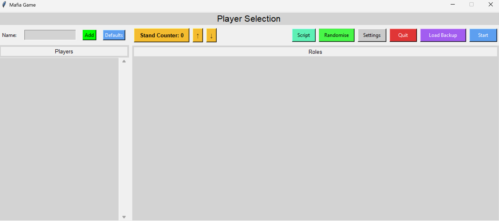
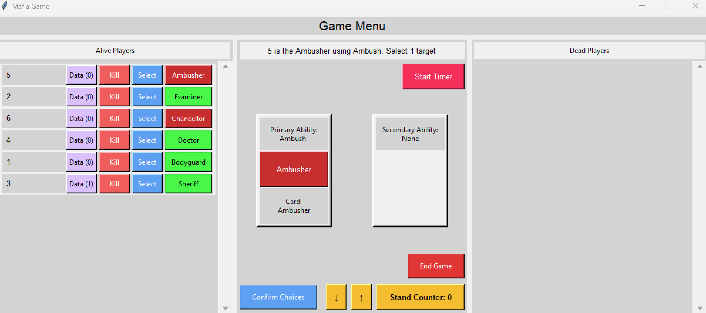
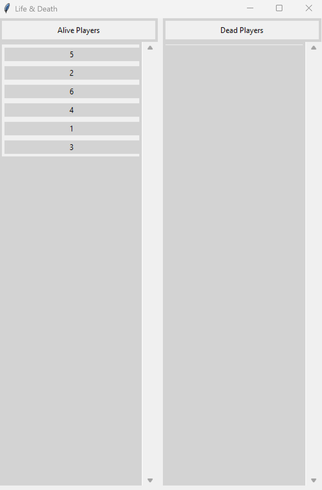
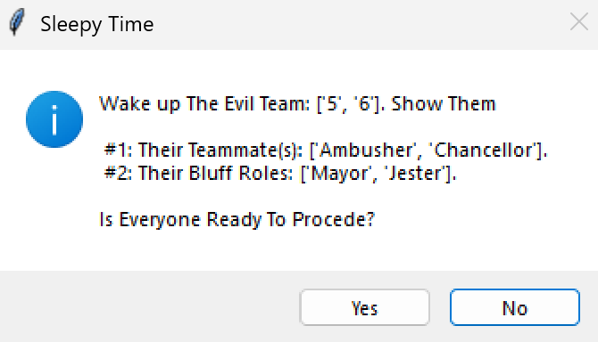
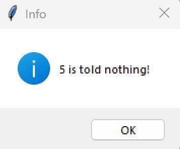

# Mafia GM Tool #
A Program to allocate roles in a modded game of mafia & assist in running the game.

## Role Info
Simplified Role Sheet [Here](./Simplified-Role-Sheet.odp)

Detailed Role Descriptions [Here](https://docs.google.com/document/d/1GgAKyC6A48pYSVx96a-Yz4girl6JzwH0_gW3UI0X_n0/edit?usp=sharing)

## Running The Game

### Before Starting The Program
To begin, you will require a means of distributing the roles secretly to players (i.e. printed cards) and a way to communicate text information to players.

If you intend to run a game for the same group of people for multiple rounds, it is recommended to create a `defualts.txt` file and listing the names of your players in it.

If you want to filter which roles you want to be in play, you can add a `JSON` file in the `Scripts` folder following the format of the other two files. Note that:
- Roles in nested lists cannot have duplicates.
- There is only ever 1 evil leader in play
- `overflow` stores a duplicatable role used to allow for a theoretically uncapped player size but is not recommended.
- There must be one
- The `max_players` used to determine when overflow is used is automatically calculated on loading.
- The `evil_support` is used to determine at which player counts minions are added in.

### Setup Menu
Upon starting the program, you are greeted with the setup menu:

You can either add players by typing their name into the textbox and use the `add` button or enter key to type it in or you can use the `defaults` button to load the contents of `defaults.txt`. Doing this will load a set of roles into the roles tobe

From there, you can use the `script` button to load any valid JSON file in the `Scripts` folder. By default, the `everything.json` file is loaded.

To change what roles are in play, you can `randomise` them or click individual roles to cycle through the remaining options.

The `settings` button allows you to adjust some features in the game, such as a starting drunk and instant death gambler.

From there, you may press `quit` to terminate the program, press `Load Backup` if a game previously crashed or press `play` to confirm your choices and move on.

The `Stand Counter` is a silly inside joke function that can be incremented with the up and down arrows or with the up and down arrow keys. Feel free to use this for whatever :D.

### Night Phase
Upon starting a round, 2 menus will appear. These being the game menu and a secondary life and death display that can be used to show players:

 

Shortly after, a popup will appear for the evil team information. This contains the in play evil roles & a set of bluff roles (1 per player):

You may choose to give them a different set of bluff roles at your own discresion.

To begin, all players should recieve their roles as shown in the program in the `Alive Players` tab. Once this is done, all players should close their eyes.

You first wake up the evil team to show them their info before dismissing the popup shown earlier. Once this is done, you can wake players up to use their abilities.

#### Using Abilities
If the program produces a popus saying that the player does nothing, you can skip past them.

If the program provides a popup asking if a player wants to use their ability, wake them up to ask them so and to pick any targets if they do.

If the program asks for a number, wake the player for a selection. This will correspond to a category or sub-ability so the detailed role doc associates the number with the selection.

If the program says to `Select` [N] `Targets`, then ask the corresponding player for their pick(s) and use the `Select` button attached to each player to do so. The program will throw errors popups if the selections are invalid. Once the selections are made, press `Confirm Choices`.

At this point, no player will recieve information.

#### Giving Information
Once all the roles have used their night abilities, the program will determine what happens. Afterwards, an information phase will begin. Each players information is presented as a popup:

If the popup says a player `is told nothing` then don't wake them.

If the information says `(poisoned/drunk)`, the information they recieve may be wrong. Feel free to also adjust what false info a player as long as they aren't told they are poisoned or drunk.

If a player recieves information, wake the player (possibly for the second time that night) to give them the information.

### Voting Phase
